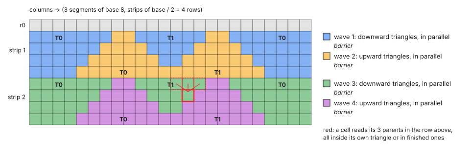
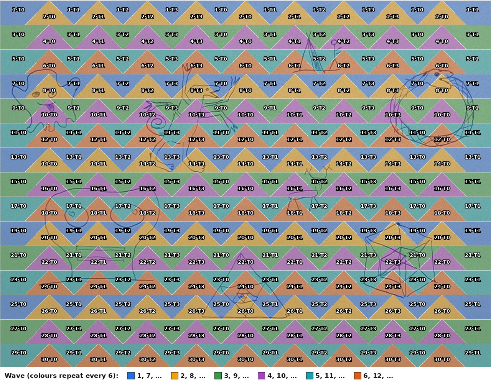
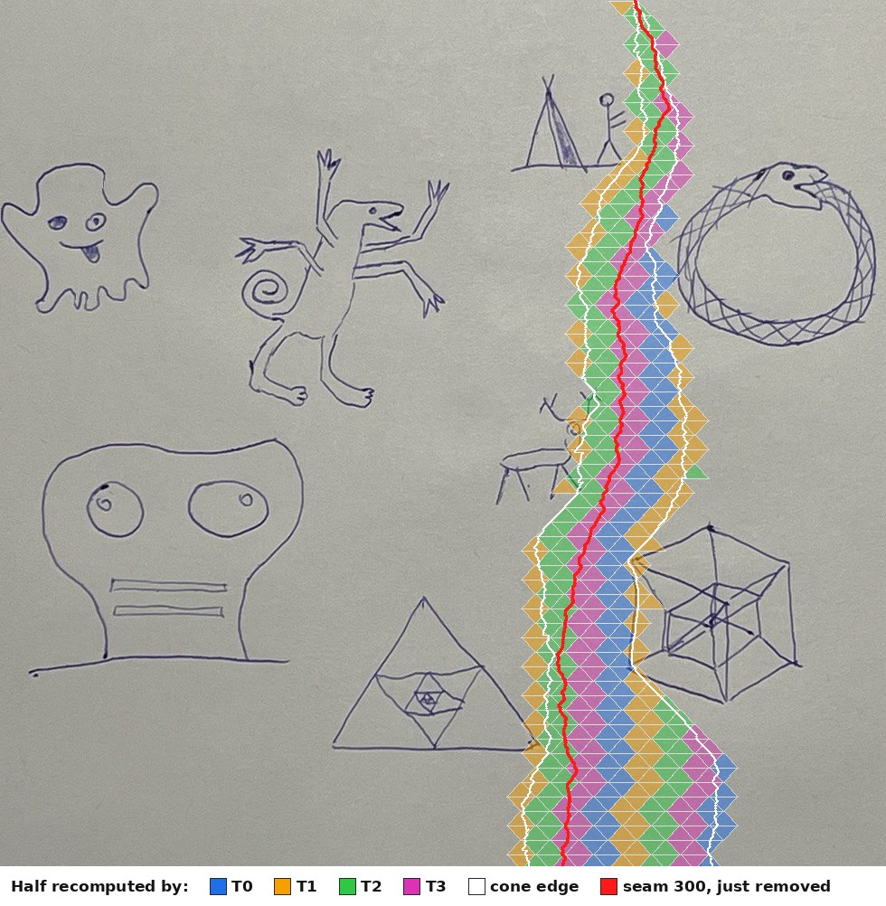
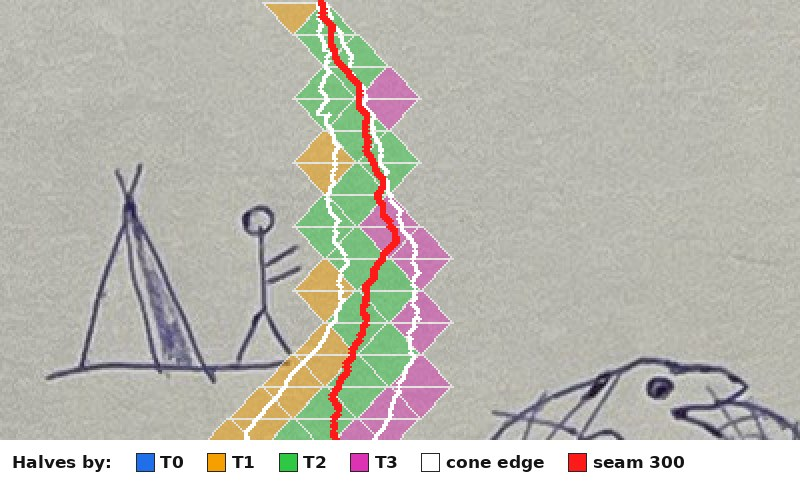
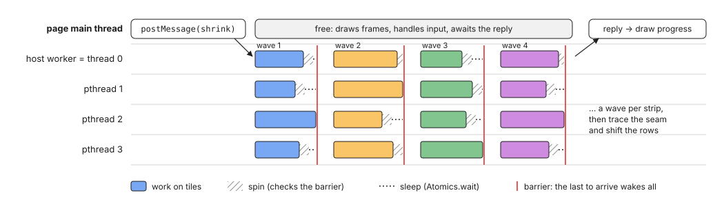
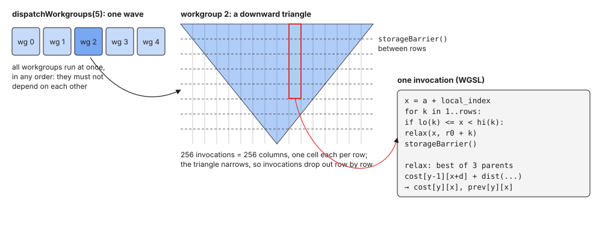
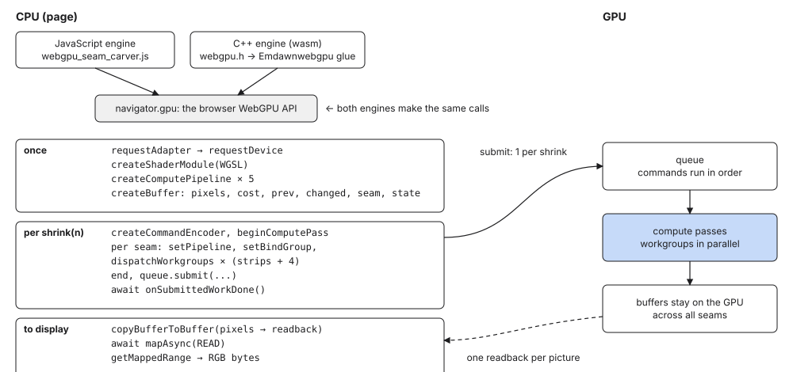
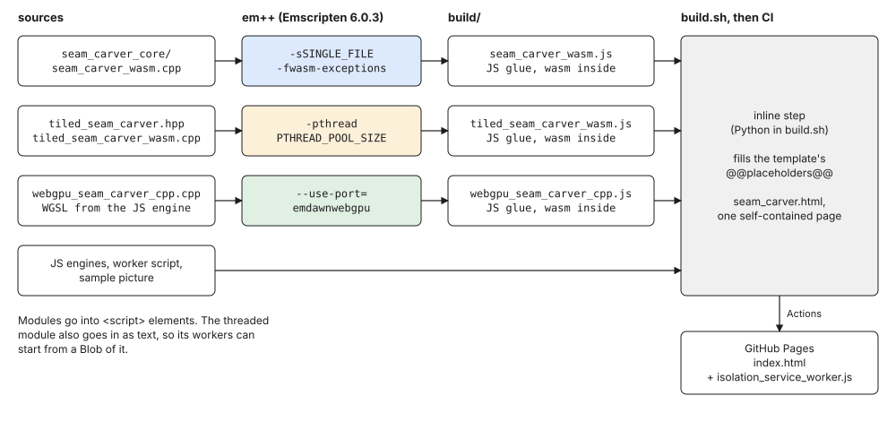
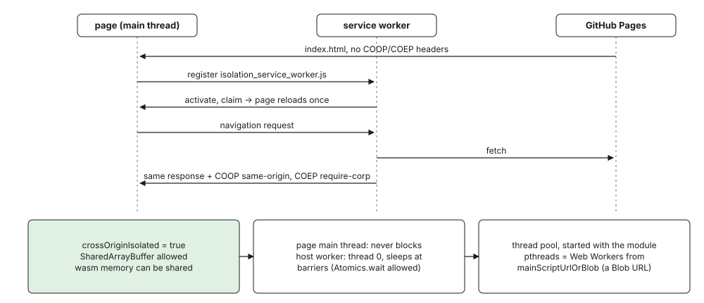

# Parallel seam carving: threads, the GPU, and the browser

How the two parallel engines of the [seam carver page](../wasm_seam_carver/) split one seam's work:
**C++ on threads** (`parallel_seam_carver/tiled_seam_carver.hpp`, compiled to multithreaded
WebAssembly) and **WebGPU** (the same algorithm as compute shaders, driven from JavaScript or from
C++). Also covered: how the threads synchronize, what the page's main thread does meanwhile, how the
build turns all of it into one HTML file, and the workaround that makes threads possible there.

All pictures are computed from the engines themselves, on the sample picture
`tundra_1280x958.jpeg`; the numbers come from the measurements in the commit messages.

## 1. The work: one row after another

Removing one seam takes three steps:

1. **Path costs.** Every pixel gets the cost of the cheapest path from the top row down to it: the
   cheapest of its three parents (up-left, up, up-right) plus the colour distance to that parent.
   It also remembers which parent won.
2. **Trace.** The cheapest pixel of the bottom row, then its parents back to the top: the seam.
3. **Shift.** Every row moves its pixels right of the seam one column left.

Step 1 is nearly all the work: about 1.2 million cells for the full 1280 × 958 picture. A cell needs
the row above it to be finished, so rows can't be computed side by side. Only the cells within a
row are independent.


*The first seam, in red. It runs down the blank paper along the left edge, where neighbouring
pixels differ least.*

## 2. Splitting a full recompute into diamonds

Synchronizing all threads after every row would cost a barrier per row, 957 per seam. Tiling needs
far fewer. Rows are grouped into **strips** of `h = base / 2` rows. The first version split each
strip into two **waves** of triangles, with a barrier after each:

- **Downward triangles.** Each thread takes a segment of `base` columns from the row above the
  strip and fills a triangle below it, one column narrower on each side per row.
- **Upward triangles.** The gaps between the downward triangles, filled once those are finished,
  since their sides read them.

But an upward triangle ends on a full row `base` columns wide, and that row is all that the
downward triangle beneath it, in the next strip, needs. So the thread that finishes an upward
triangle can go straight on into the one below, without waiting for the others. Together they form
a **diamond** centred on a column `c`:

- **Upper half**, the upward triangle of strip `t − 1`: columns `[c − k, c + k)` of its row `k`. It
  reads the row above the strip under its tip and, at its sides, the lower halves of the previous
  wave.
- **Lower half**, the downward triangle of strip `t`: columns `[c − h + k, c + h − k)`. It reads
  only its own upper half's last row.

Each wave is one row of diamonds, offset by half a diamond from the previous wave, so that its upper
halves fill the gaps between the previous wave's lower halves. That is one barrier per strip instead
of two. The first wave has only lower halves, and also zeroes the top row's costs under them; the
last has only upper halves.



*The same two strips of a picture 24 columns wide, `base` 8: four waves of triangles, three of
diamonds. Each colour is a wave, `T0`/`T1` the thread that computes the tile, and thick lines are
tile borders. In red, a lower half's first row: its three parents all lie in its own upper half's
last row.*

On the sample picture with `base` 128, a strip is 64 rows high. 15 strips make **16 waves** of
diamonds instead of 30 of triangles, and 19 barriers per seam instead of 34: one per wave, plus
three for the trace, the shift and the width update. The four threads take diamonds round-robin.
The figure uses `base` 128 so that the labels fit; the threads use 64 by default, which measured
fastest (section 3).



*Full recompute on 4 threads, `base` 128. Each label is `wave·thread`: wave 0 is the lower halves
alone along the top, wave 1 the first whole diamonds between them, and so on down to wave 15, upper
halves alone along the bottom. Colours repeat every six waves.*

## 3. Incremental updates: only the cone

Most of a full recompute repeats the previous seam's work. After a seam is removed, the costs and
parents shift left together with the pixels, and nearly all of them are still right. A cell can
only change in two cases:

- **Its parents moved.** These "seeds" are the cells next to the removed seam, a few in each row.
- **A parent's cost changed.** Changes spread down from the seeds by at most one column per row on
  each side, so the changed cells form a **cone** around the removed seam that widens downward.

On the sample picture the cone averages 125 columns: about 21 near the top and 225 near the bottom.
That is 13% of the cells a full recompute evaluates.

The parallel engines cover the cone with finer diamonds, `base` 32: strips 16 rows high, 61 waves
per seam. A half is **dirty** if it holds a seed or reads a cell whose cost changed in this seam.
Only dirty halves are recomputed, and each recomputed cell whose cost changes is marked with the
seam's number (its epoch), so that later dirty tests can see it. A diamond's halves are tested
separately: the upper one by the cells it reads outside itself, the lower one by its upper half's
last row, by the same thread right after. A clean half's inputs are unchanged, so its stored costs
are still exactly what a full recompute would produce. That keeps the results bit-identical to the
single-threaded core.


*After removing seam 1 (red): the cone's edges (white) and the 643 dirty halves, coloured by the
thread that recomputed them, as logged from the engine. The cone can only spread right here, since
the seam runs along the left border.*



*After removing seam 300, in the middle of the narrowed picture: 480 dirty halves. The cone is
narrow at the top and widens as cost changes spread down.*



*The top of the same cone, twice as large. Diamonds are 32 columns wide; where both halves of one
were dirty, the same thread recomputed both. The white cone edges stay inside the dirty halves.*

The split across threads is uneven: after seam 1, threads 0 to 3 recomputed 222, 175, 134 and
112 halves. Each wave deals out its candidate diamonds round-robin, starting with thread 0, and near
the top a wave has only one or two. Even so, diamonds 32 wide recompute only 16% of a full
recompute, 1.21 times the core's own incremental update.

### What the diamonds gained

| 600 seams of the sample picture | triangles | diamonds |
|---|---|---|
| Full recompute, 4 threads (4-core Linux VM, native) | 2460 ms | **2090 ms** |
| Incremental, 4 threads (native) | 650 ms | **610 ms** |
| Incremental in WebAssembly, 2 threads (Chromium, 2 cores) | 2.03 s | 2.03 s |
| Incremental in WebAssembly, 4 threads on 2 cores | 3.81 s | **2.89 s** |
| Incremental in WebAssembly, 8 threads on 2 cores | 5.68 s | **3.76 s** |

For comparison, the single-threaded core's incremental update takes 1646 ms natively and 3.39 s
in Chromium.

Natively, halving the barriers gained less than it seems. A barrier costs about a microsecond, so
the incremental update's 64 barriers per seam instead of 124 saved about 40 ms. Most of the time a
thread spends at barriers, about 190 ms of the 610, it waits for the slowest diamond of its wave,
and near the cone's tip a wave has only one or two. Diamonds don't shorten that chain, since each
does the work of two triangles. Full recomputes gained more, partly because the best tile width
moved: triangles were fastest 128 wide, diamonds 64 wide.

Diamonds pay off where waking a thread is expensive. With more threads than cores, waiting
threads sleep, and every barrier has to wake them again: there, halving the barriers made
incremental updates a quarter to a third faster.

## 4. How the threads synchronize

All threads run the same loop over waves. Between waves they meet at a barrier, a counter and a
phase number in shared memory:

```cpp
void arrive_and_wait() {
    const int phase = phase_.load(std::memory_order_acquire);
    if (arrived_.fetch_add(1, std::memory_order_acq_rel) + 1 == count_) {
        arrived_.store(0, std::memory_order_relaxed);        // last to arrive: reset,
        phase_.store(phase + 1, std::memory_order_release);  // open the next phase,
        wake_all();                                          // wake the sleepers
        return;
    }
    for (int i = 0; i < spins_; ++i)                         // spin a while...
        if (phase_.load(std::memory_order_acquire) != phase) return;
    while (phase_.load(std::memory_order_acquire) == phase)  // ...then sleep:
        sleep_while(phase);                                  // Atomics.wait in wasm
}
```

- **Visibility.** The release store of the new phase and the acquire loads that see it make every
  cell written before the barrier visible to every thread after it.
- **Spin, then sleep.** An incremental wave holds only microseconds of work, so waking a sleeping
  thread can cost more than the wave itself. Threads first check the phase up to 100,000 times
  (about 50 µs) when every thread has a core of its own. When there are more threads than cores,
  they check only 1,000 times, so that waiting threads don't take the CPU from working ones.
  `?spins=N` in the page's address overrides this.
- **Why not `std::barrier`.** In WebAssembly it spins for up to about 64 µs and asks JavaScript for
  the time while doing so. With 8 threads on 2 cores it took 2.5 times as long as 2 threads; with
  this barrier, about as long.



*One request, `shrink 10 seams`, over time. The threads finish each wave at different times, wait
at the barrier (spin, then sleep) and continue together. The page's main thread only sends the
request and handles the reply.*

### What the page's main thread does meanwhile

Nothing that blocks:

1. The page splits a shrink into steps of 10 seams.
2. For each step it posts a message to a **dedicated Web Worker** that hosts the WebAssembly module.
   That worker calls `shrink_horizontally()` and works as thread 0. The other threads are the
   module's own workers, started together with the module.
3. The main thread returns to its event loop at once. It keeps drawing frames and handling input,
   and awaits the reply as a promise.
4. When the reply arrives, it repaints the picture and sends the next step.

Earlier versions ran thread 0 on the main thread itself. A browser's main thread may not sleep, so
Emscripten made it spin at every barrier. That burned a core the other threads needed and froze the
page for a whole step: frame gaps of about 1 s on 2 cores, against about 20 ms now.

The WebGPU engines also leave the main thread free. It records and submits the GPU commands for a
step, which takes a few milliseconds, then awaits `onSubmittedWorkDone()` while the GPU works.

## 5. A graphics API for general computation: WebGPU

WebGPU exposes the GPU's **compute pipelines** next to its graphics ones. A compute pipeline runs
a function written in WGSL, the **shader**, over a grid of **workgroups**. Each workgroup is a group
of **invocations** that run together, can share fast memory and can wait for each other at
barriers. Workgroups can't wait for each other. Only the order of dispatches separates their work.

That maps onto the tiling directly:

| Seam carving | WebGPU |
|---|---|
| a wave (a row of diamonds) | one `dispatchWorkgroups()` |
| a diamond | one workgroup |
| a column of the diamond | one invocation |
| the rows inside a diamond | a loop, with `storageBarrier()` between rows |
| the barrier between waves | the boundary between two dispatches |



*One wave on the GPU. Each workgroup fills one diamond. Each of its 256 invocations owns a column,
computes one cell per row and waits at `storageBarrier()` before the next row.*

The full recompute's shader, from `webgpu_seam_carver.js`. `centre()`, `upper_r0()` and the other
helpers derive the diamond's place and its halves' rows from the wave number:

```wgsl
@compute @workgroup_size(BASE)
fn diamonds(@builtin(workgroup_id) group: vec3u,
            @builtin(local_invocation_index) local: u32) {
  let w = uniform_width(local);
  let c = centre(group.x);
  if (c >= w + HALF) {
    return;
  }
  let x = i32(c) - i32(HALF) + i32(local);
  if (params.wave == 0u) {
    if (x >= 0 && x < i32(w)) {
      cost[u32(x)] = 0.0;
    }
    storageBarrier();
  }
  let r0 = upper_r0();
  for (var k = 1u; k <= upper_rows(); k++) {
    if (in_upper(x, i32(c), k, w)) {
      relax(u32(x), r0 + k, w);  // best of 3 parents: one cell's cost and parent
    }
    storageBarrier();
  }
  let r1 = lower_r0();
  for (var k = 1u; k <= lower_rows(); k++) {
    if (in_lower(x, i32(c), k, w)) {
      relax(u32(x), r1 + k, w);
    }
    storageBarrier();
  }
}
```

The program on the CPU only prepares and orders this work:



*Setup happens once. A shrink records all of its seams' dispatches into one command buffer and
submits it once. The picture, costs and seams stay on the GPU, and only the final picture is read
back. The JavaScript and C++ engines make the same calls; in C++ they go through `webgpu.h`, which
Emdawnwebgpu turns into JavaScript WebGPU calls.*

How it differs from the threads:

- **No f64.** WGSL has no 64-bit floats, so costs are f32. The colour distance comes from a table of
  f32 square roots, and f32 additions are correctly rounded, so every run is exact for f32. Near-ties
  that f64 separates can still pick other seams: on the sample picture the first seam already
  differs in 124 of its 958 rows, at an equal cost.
- **Incremental, with wide tiles.** Every diamond of a wave is launched, and each of its halves
  tests itself and skips its rows if clean. A GPU computes all diamonds of a wave together, and
  every seam still walks all 958 rows in sequence, so narrow tiles would only add dispatches. The
  default tile stays 256 wide, the same passes as a full recompute: 9 waves per seam, where
  triangles took 16. `?tile=N` tries others.

## 6. The build: C++ to WebAssembly to one HTML file



*`wasm_seam_carver/build.sh` runs three `em++` commands and a Python inline step. The Pages
workflow runs the script and publishes the page with its service worker.*

To build the page yourself, run `wasm_seam_carver/build.sh` on macOS or Linux with git and python3.
It needs Emscripten 6.0.3 and gets it through `wasm_seam_carver/emscripten.sh`: the `emcc` already
on the `PATH` if it is that version, otherwise the repo's own copy in `.emsdk/`, installed on the
first build (about 1 GB). The Pages workflow does the same and caches `.emsdk/`, so the version is
pinned in one place. `. wasm_seam_carver/emscripten.sh` puts that `emcc` on a shell's `PATH`.

| Module | Sources | Notable flags |
|---|---|---|
| `seam_carver_wasm.js` | `seam_carver_core/`, embind bindings | `-sSINGLE_FILE` (the wasm inside the JS), `-fwasm-exceptions` |
| `tiled_seam_carver_wasm.js` | `tiled_seam_carver.hpp`, bindings | `-pthread`, `-sPTHREAD_POOL_SIZE=Module.poolSize…`, `-sINCOMING_MODULE_JS_API=mainScriptUrlOrBlob,…` |
| `webgpu_seam_carver_cpp.js` | `webgpu_seam_carver_cpp.cpp` | `--use-port=emdawnwebgpu`: `webgpu.h` from the Dawn release this Emscripten pins |

- **Single source for WGSL.** The shader code lives only in `webgpu_seam_carver.js`. `build.sh`
  extracts it into a C++ raw string literal (`build/seam_carver_wgsl.inc`) for the C++ engine.
- **Embedding.** The inline step fills the `@@placeholders@@` of `seam_carver.template.html` with
  the three modules, the JavaScript engines, the worker script and the sample picture. It first
  escapes every closing script tag inside them, which would end the inline script early. The
  threaded module goes in twice, as code and as text (a `<script type="text/plain">`), because its
  workers must start from a Blob of that text.
- **One file.** The result opens straight from disk. Only the threads need a web server, for the
  reason below.

## 7. Note: the workaround that unlocks threads in the browser

WebAssembly threads share one `SharedArrayBuffer` as memory. Browsers only allow that on
**cross-origin isolated** pages, which a server marks with two response headers:
`Cross-Origin-Opener-Policy: same-origin` and `Cross-Origin-Embedder-Policy: require-corp`.
GitHub Pages can't send custom headers, and a page opened from disk gets none. The page works
around this in four steps:

1. **A service worker adds the headers.** On the first visit the page registers
   `isolation_service_worker.js`, waits for it to take control and reloads once. From then on the
   worker answers the page's own navigations, passing the server's response through with the two
   headers added. The page then reports `crossOriginIsolated`. A per-tab flag prevents a reload
   loop in browsers that ignore the headers. From disk no service worker is possible, so the
   threads engine stays off and says why.
2. **The module runs in a dedicated worker.** There, the calling thread may sleep at barriers
   instead of spinning on the main thread (section 4).
3. **The thread pool starts with the module.** Starting a thread needs the event loop of the
   thread that starts it, and that one is busy while seams are removed. So `PTHREAD_POOL_SIZE`
   starts all workers up front, sized by the page with `Module.poolSize`.
4. **The workers start from a Blob.** They run the module's own script, which only exists inline
   in the page. The page passes a Blob URL of its text as `mainScriptUrlOrBlob`. Emscripten 6
   ignores that option unless the build lists it in `INCOMING_MODULE_JS_API`; without it, the
   workers started the host worker's script and the page hung while loading.



*First visit: the server's response lacks the headers. The service worker takes over, the page
reloads once and its navigation comes back with them. The threads then run off the main thread,
in a pool started with the module.*
